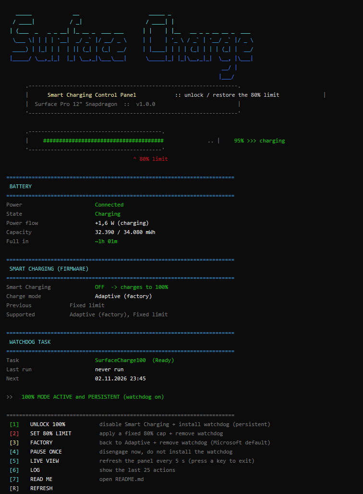
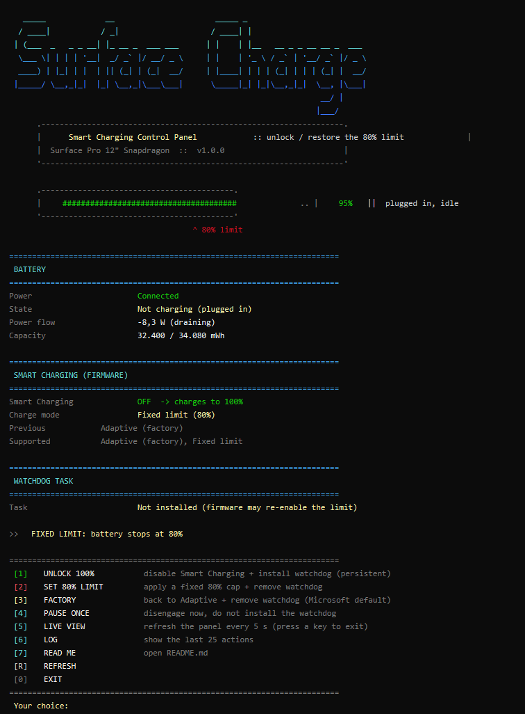

# Surface Charge Limit

**Turn the Surface "charge to 80%" smart-charging limit on and off — without the Surface app.**

🇹🇷 **[Türkçe benioku için tıklayın →](README.tr.md)**

Recent Surface devices (Surface Pro 12", Snapdragon) cap the battery at **80%** via a firmware
feature called **Smart Charging**. The only supported switch for it lives in the **Surface app →
Battery & charging** card. On many machines that card is **missing** (a known app regression, app
`76.10212.108.0`, Oct 2026 — see [Microsoft Q&A](https://learn.microsoft.com/en-us/answers/questions/2332067/option-to-turn-smart-chargin-off-doesnt-appear-in)),
and there is **no registry key, `powercfg`, or command line** that Microsoft documents to toggle it.

This tool talks to the **same battery driver the Surface app uses**, so you can unlock charging to
100% (or re-apply the 80% limit) from a small coloured console panel — no app required.

> Battery Limit in the UEFI is a *different* feature (it caps at 50% for kiosks) and `powercfg`'s
> "reserve battery level" is unrelated. Neither one controls the 80% Smart Charging limit.

---

## Screenshots

| 100% unlocked (persistent) | Fixed 80% limit |
|---|---|
|  |  |

The panel shows, with live data: battery %, power flow (W), capacity, time-to-full, battery health
and cycle count; the firmware Smart-Charging state (ON/OFF, charge mode, supported modes); and the
watchdog task status. The bottom line summarises everything in one sentence.

---

## Features

- **One keypress to unlock to 100%** or to re-apply a fixed **80%** cap, or to return to Microsoft's
  **Adaptive** default.
- **Live status panel** — reads real firmware values, not guesses.
- **Watchdog task** — Smart Charging re-arms itself over time; an optional `SurfaceCharge100`
  scheduled task (startup + hourly) keeps 100% charging unlocked for good.
- **Bilingual** — English (`SurfaceCharge.bat`) and Turkish (`SurfaceSarj.bat`).
- **Reversible & safe** — touches no registry, UEFI, or drivers. Only sends the battery commands the
  Surface app itself sends. Everything can be undone from option **[3] Factory**.
- **No install, no dependencies** — two files, Windows PowerShell 5.1 (built into Windows 11).

---

## Requirements

- Surface Pro 12" (1st Ed, Snapdragon) or another Surface that exposes the **Surface Battery Client
  Driver (SBCD)**. The tool detects the interface and refuses to run otherwise.
- Windows 11, Windows PowerShell 5.1 (preinstalled).
- **Administrator rights** (the firmware commands require it — the `.bat` self-elevates).

---

## Quick start

1. **[Download the latest release zip →](https://github.com/TonbiLX/surface-charge-limit/releases/latest)**
   (`SurfaceChargeLimit-v1.0.0.zip`).
2. Unzip anywhere.
3. Double-click **`SurfaceCharge.bat`** (English) or **`SurfaceSarj.bat`** (Turkish).
4. Approve the UAC prompt.
5. Press **`1`** to unlock charging to 100%.

Direct download link:
`https://github.com/TonbiLX/surface-charge-limit/releases/latest/download/SurfaceChargeLimit-v1.0.0.zip`

---

## Menu

| Key | Action | What it does |
|----|--------|--------------|
| **1** | **Unlock 100%** | Disables Smart Charging now **and** installs the watchdog task (persistent). |
| **2** | **Set 80% limit** | Applies a fixed 80% cap and removes the watchdog. |
| **3** | **Factory** | Returns to Adaptive mode and removes the watchdog (Microsoft default). |
| **4** | **Pause once** | Disengages Smart Charging right now, without installing the watchdog. |
| **5** | **Live view** | Refreshes the panel every 5 s. |
| **6** | **Log** | Shows the last 25 actions. |
| **7** | **Read me** | Opens this file. |
| **R / 0** | Refresh / Exit | |

### Command line

```bat
SurfaceCharge.bat unlock     :: unlock to 100% + watchdog
SurfaceCharge.bat limit80    :: fixed 80% cap
SurfaceCharge.bat default    :: Adaptive + remove watchdog
SurfaceCharge.bat status     :: panel only
```

---

## Why the watchdog task?

Microsoft states Smart Charging is **always on standby** and re-engages by itself when the device
stays plugged in for a long time or runs warm. This hardware supports only two charge modes
(`Adaptive` and `Fixed limit`) — there is no permanent "no limit" mode. So the only way to keep 100%
charging reliably is to re-send the "disengage" command periodically.

`SurfaceCharge100` runs as **SYSTEM**, 2 minutes after each boot and once an hour. If the limit is
already off, the command is a no-op (`NotEngaged`). Remove it any time with option **[2]** or **[3]**.

---

## How it works

Extracted from the Surface app's `Services\BatteryDm.dll` (`SDMA.Microservice.Cmd.Battery`, .NET IL).
The tool sends the exact commands that app's "Battery & charging" card sends.

| Item | Value |
|---|---|
| Device interface | Surface Battery Client Driver (SBCD) `{31076642-1572-4FBB-A5DD-4B879B515476}`; fallback SID `{54F596C1-3B0D-40F2-97A4-FCBCFD253D3B}` |
| IOCTL | `0x00225C00` = `CTL_CODE(0x22, 0x700, METHOD_BUFFERED, FILE_READ_ACCESS)` |
| Packet | `[totalLen, 0x03, 0x00, command, 0x00, data…]` |
| `5` | Get protection policy (bit `0x10` = Smart Charging supported) |
| `6` | Get BCL status: `0` off · `1` active |
| `7` | Get BCL countdown (seconds) |
| `8` | **Force BCL disengage** — the card's "Pause": `0` ok · `1` countdown · `2` already off |
| `15` / `16` | Set / get charge mode. Mode: `0` Adaptive · `1` Fixed limit (50–80) · `2` Unlimited (unsupported here). Data = mode (1 B) + settings (24 B) |

- **Administrator required.** A normal user can open the interface, but the IOCTL returns
  `ERROR_ACCESS_DENIED (5)`.
- Nothing is written to the registry, UEFI, or drivers — only runtime firmware commands, all
  reversible via **[3] Factory**.

---

## Files

```
surface-charge-limit/
├── src/
│   ├── SurfaceCharge.ps1   engine (menu, panel, firmware commands)
│   ├── SurfaceCharge.bat   English launcher (self-elevates)
│   └── SurfaceSarj.bat     Turkish launcher (self-elevates)
├── docs/                   screenshots
├── README.md               this file (English)
├── README.tr.md            Turkish
└── LICENSE                 MIT
```

---

## Troubleshooting

| Symptom | Fix |
|---|---|
| `Surface battery interface not found` | SurfaceService / battery driver missing. Install Surface drivers from Windows Update. |
| `Firmware unreadable - administrator required` | You opened the `.ps1` directly. Use the `.bat`. |
| `CountdownInProgress` | The firmware is mid-countdown. If the watchdog is installed it retries within an hour. |
| Commands fail after a Surface app update | Microsoft may have changed the protocol; `BatteryDm.dll` needs re-reading. Open an issue. |

---

## Disclaimer

Community tool, **not affiliated with Microsoft**. It uses the same documented battery interface the
Surface app uses, writes nothing persistent to your system, and is fully reversible — but it is
provided **as is**, without warranty (see [LICENSE](LICENSE)). Charging to 100% all the time can
increase long-term battery wear; that trade-off is yours to make.

## License

[MIT](LICENSE) © 2026 TonbiLX
