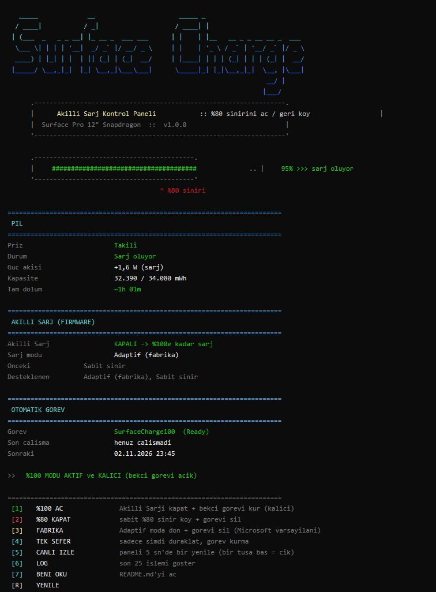
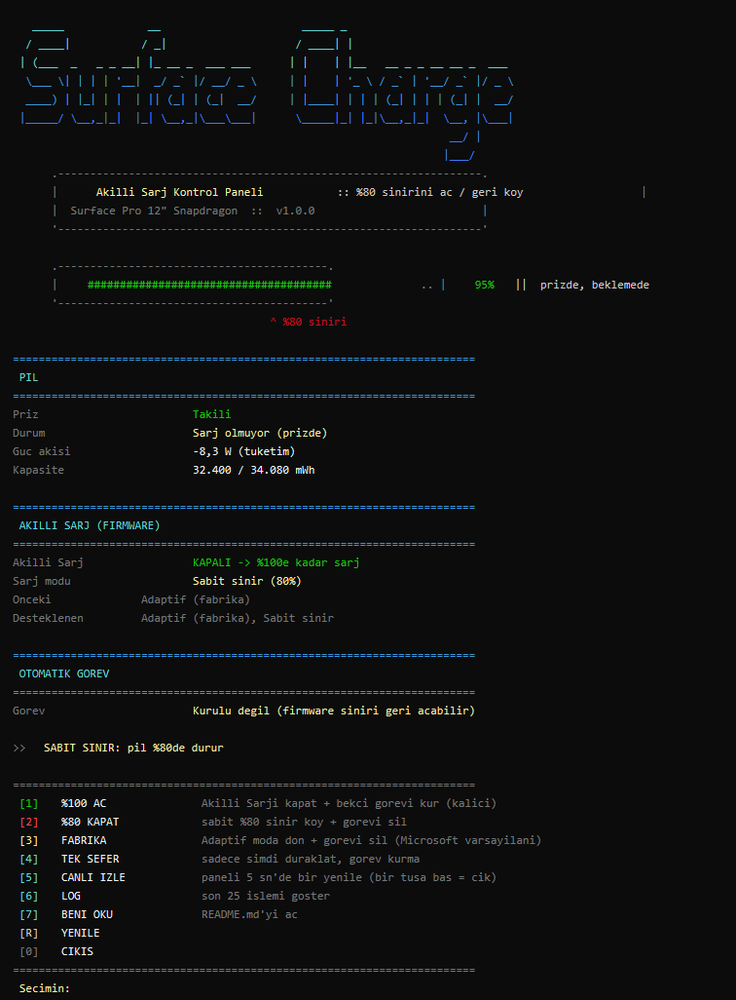

# Surface Şarj Limiti

**Surface'in "%80'de şarjı durdur" akıllı şarj sınırını — Surface uygulaması olmadan — aç/kapat.**

🇬🇧 **[Click for the English readme →](README.md)**

Yeni Surface cihazları (Surface Pro 12", Snapdragon) pili **%80'de** tutuyor. Bunu yapan firmware
özelliğinin adı **Akıllı Şarj**. Tek resmi düğmesi **Surface uygulaması → Pil ve şarj** kartında.
Birçok cihazda bu kart **görünmüyor** (bilinen bir uygulama hatası, `76.10212.108.0`, Ekim 2026 —
[Microsoft Q&A](https://learn.microsoft.com/en-us/answers/questions/2332067/option-to-turn-smart-chargin-off-doesnt-appear-in)),
ve Microsoft'un belgelediği **hiçbir kayıt defteri anahtarı, `powercfg` ya da komut satırı** yok.

Bu araç **Surface uygulamasının kullandığı pil sürücüsüyle** konuşur; böylece şarjı %100'e açabilir
(ya da %80 sınırını geri koyabilir) — küçük, renkli bir konsol panelinden, uygulamaya gerek kalmadan.

> UEFI'deki Battery Limit *başka* bir özelliktir (kiosk için %50'de durdurur) ve `powercfg`'nin
> "pil düzeyini koru" ayarı ilgisizdir. İkisi de %80 Akıllı Şarj sınırını kontrol etmez.

---

## Ekran görüntüleri

| %100 açık (kalıcı) | Sabit %80 sınır |
|---|---|
|  |  |

Panel canlı veriyle şunları gösterir: pil %, güç akışı (W), kapasite, tam dolum süresi, pil sağlığı
ve çevrim sayısı; firmware Akıllı Şarj durumu (AÇIK/KAPALI, şarj modu, desteklenen modlar); ve
otomatik görev durumu. En alttaki satır her şeyi tek cümlede özetler.

---

## Özellikler

- **Tek tuşla %100'e aç**, sabit **%80** sınır koy ya da Microsoft'un **Adaptif** varsayılanına dön.
- **Canlı durum paneli** — tahmin değil, gerçek firmware değerlerini okur.
- **Otomatik görev** — Akıllı Şarj zamanla kendini tekrar devreye alır; isteğe bağlı
  `SurfaceCharge100` zamanlanmış görevi (açılış + saatlik) %100 şarjı kalıcı tutar.
- **İki dilli** — İngilizce (`SurfaceCharge.bat`) ve Türkçe (`SurfaceSarj.bat`).
- **Geri alınabilir ve güvenli** — kayıt defterine, UEFI'ye veya sürücülere dokunmaz. Yalnızca
  Surface uygulamasının gönderdiği pil komutlarını gönderir. Her şey **[3] Fabrika** ile geri alınır.
- **Kurulum yok, bağımlılık yok** — iki dosya, Windows PowerShell 5.1 (Windows 11'de hazır gelir).

---

## Gereksinimler

- Surface Pro 12" (1. nesil, Snapdragon) ya da **Surface Battery Client Driver (SBCD)** sunan başka
  bir Surface. Araç arayüzü algılar, yoksa çalışmayı reddeder.
- Windows 11, Windows PowerShell 5.1 (hazır gelir).
- **Yönetici yetkisi** (firmware komutları için şart — `.bat` kendini yükseltir).

---

## Hızlı başlangıç

1. **[Son sürüm zip'ini indir →](https://github.com/TonbiLX/surface-charge-limit/releases/latest)**
   (`SurfaceChargeLimit-v1.0.0.zip`).
2. Herhangi bir yere çıkar.
3. **`SurfaceSarj.bat`** (Türkçe) ya da **`SurfaceCharge.bat`** (İngilizce) dosyasına çift tıkla.
4. UAC onayını ver.
5. **`1`**'e basarak şarjı %100'e aç.

Doğrudan indirme bağlantısı:
`https://github.com/TonbiLX/surface-charge-limit/releases/latest/download/SurfaceChargeLimit-v1.0.0.zip`

---

## Menü

| Tuş | İşlem | Ne yapar |
|----|--------|----------|
| **1** | **%100 Aç** | Akıllı Şarj'ı kapatır **ve** otomatik görevi kurar (kalıcı). |
| **2** | **%80 Kapat** | Sabit %80 sınır koyar ve görevi siler. |
| **3** | **Fabrika** | Adaptif moda döner ve görevi siler (Microsoft varsayılanı). |
| **4** | **Tek sefer** | Akıllı Şarj'ı yalnızca şimdi duraklatır, görev kurmaz. |
| **5** | **Canlı izle** | Paneli 5 saniyede bir yeniler. |
| **6** | **Log** | Son 25 işlemi gösterir. |
| **7** | **Beni oku** | Bu dosyayı açar. |
| **R / 0** | Yenile / Çıkış | |

### Komut satırı

```bat
SurfaceSarj.bat unlock     :: %100'e aç + görev
SurfaceSarj.bat limit80    :: sabit %80 sınır
SurfaceSarj.bat default    :: Adaptif + görevi sil
SurfaceSarj.bat status     :: yalnızca panel
```

---

## Otomatik görev neden gerekiyor?

Microsoft'a göre Akıllı Şarj **her zaman hazırda bekler** ve cihaz uzun süre prizde kalınca ya da
ısınınca kendiliğinden yeniden devreye girer. Bu donanım yalnızca iki şarj modunu destekler
(`Adaptif` ve `Sabit sınır`) — kalıcı bir "limitsiz" mod yoktur. Bu yüzden %100 şarjı güvenle
sürdürmenin tek yolu "duraklat" komutunu düzenli olarak tekrar göndermektir.

`SurfaceCharge100` görevi **SYSTEM** olarak, her açılıştan 2 dakika sonra ve saatte bir çalışır.
Sınır zaten kapalıysa komut hiçbir şey yapmaz (`NotEngaged`). İstediğin an **[2]** veya **[3]** ile
kaldırabilirsin.

---

## Nasıl çalışır?

Surface uygulamasının `Services\BatteryDm.dll` dosyasından (`SDMA.Microservice.Cmd.Battery`, .NET IL)
çıkarıldı. Araç, o kartın "Pil ve şarj" bölümünün gönderdiği komutların aynısını gönderir.

| Öğe | Değer |
|---|---|
| Cihaz arayüzü | Surface Battery Client Driver (SBCD) `{31076642-1572-4FBB-A5DD-4B879B515476}`; yedek SID `{54F596C1-3B0D-40F2-97A4-FCBCFD253D3B}` |
| IOCTL | `0x00225C00` = `CTL_CODE(0x22, 0x700, METHOD_BUFFERED, FILE_READ_ACCESS)` |
| Paket | `[toplamUzunluk, 0x03, 0x00, komut, 0x00, veri…]` |
| `5` | Koruma politikası (bit `0x10` = Akıllı Şarj destekleniyor) |
| `6` | BCL durumu: `0` kapalı · `1` aktif |
| `7` | BCL geri sayımı (saniye) |
| `8` | **Force BCL disengage** — kartın "Duraklat"ı: `0` tamam · `1` geri sayım · `2` zaten kapalı |
| `15` / `16` | Şarj modunu yaz / oku. Mod: `0` Adaptif · `1` Sabit sınır (50–80) · `2` Limitsiz (burada desteklenmez). Veri = mod (1 B) + ayar (24 B) |

- **Yönetici gerekir.** Normal kullanıcı arayüzü açabilir ama IOCTL `ERROR_ACCESS_DENIED (5)` döner.
- Kayıt defterine, UEFI'ye ya da sürücülere hiçbir şey yazılmaz — yalnızca çalışma zamanı firmware
  komutları, hepsi **[3] Fabrika** ile geri alınabilir.

---

## Dosyalar

```
surface-charge-limit/
├── src/
│   ├── SurfaceCharge.ps1   motor (menü, panel, firmware komutları)
│   ├── SurfaceCharge.bat   İngilizce başlatıcı (kendini yükseltir)
│   └── SurfaceSarj.bat     Türkçe başlatıcı (kendini yükseltir)
├── docs/                   ekran görüntüleri
├── README.md               İngilizce
├── README.tr.md            bu dosya (Türkçe)
└── LICENSE                 MIT
```

---

## Sorun giderme

| Belirti | Çözüm |
|---|---|
| `Surface pil arayüzü bulunamadı` | SurfaceService / pil sürücüsü eksik. Windows Update'ten Surface sürücülerini kur. |
| `Firmware okunamadı - yönetici gerekli` | `.ps1`'i doğrudan açtın. `.bat` ile aç. |
| `Geri sayım sürüyor` | Firmware geri sayımda. Görev kuruluysa en geç 1 saat içinde tekrar dener. |
| Surface uygulaması güncellemesinden sonra komutlar hata veriyor | Microsoft protokolü değiştirmiş olabilir; `BatteryDm.dll` yeniden okunmalı. Issue aç. |

---

## Sorumluluk reddi

Topluluk aracı, **Microsoft ile bağlantılı değildir**. Surface uygulamasının kullandığı belgeli pil
arayüzünü kullanır, sisteme kalıcı hiçbir şey yazmaz ve tamamen geri alınabilir — ancak **olduğu
gibi**, garantisiz sunulur (bkz. [LICENSE](LICENSE)). Pili sürekli %100'de tutmak uzun vadede pil
yıpranmasını artırabilir; bu tercih sana ait.

## Lisans

[MIT](LICENSE) © 2026 TonbiLX
